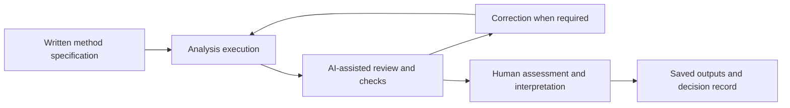

# PDAC Pipeline — Human-Supervised AI-Assisted Multi-Omic Research

This repository contains analysis code, validators, dataset metadata, method specifications, review reports and saved outputs for an integrative study of pancreatic ductal adenocarcinoma (PDAC). The study examines host transcriptional states and tumour-associated microbial profiles through a human-supervised, LLM-assisted workflow. Primary data sources are GEO **GSE172356** and NCBI BioProject **PRJNA719915**.

## 📚 Start with the workflow records

| Resource | What it provides |
| --- | --- |
| [WORKFLOW_INDEX.md](WORKFLOW_INDEX.md) | Navigation through 47 recovered instructions, from Phase 1A through Phase 11A, including correction and review loops |
| [PHASE_PROMPTS.txt](PHASE_PROMPTS.txt) | The supplied UTF-8 prompt archive, preserved byte-for-byte, with 12,299 LF-delimited lines |
| [Prompt and executing-agent record](docs/workflows/PROMPT_AND_AGENT_EXECUTION_LOG.md) | The distinction between recovered instructions, agent-authored summaries and execution evidence; the original workspace commit table |
| [Agent and skill summary](docs/workflows/PDAC_PROJECT_WORKFLOW_AGENT_SKILL_SUMMARY.md) | Historical phase roles, skill-use records and documented gaps |
| [Decision log](docs/planning/DECISION_LOG.md) | Recorded analytical decisions and changes |
| [Release update](docs/workflows/RELEASE_UPDATE_2026-10-30.md) | Scope, provenance and checks for this documentation update |

The prompt archive was supplied after retrospective recovery from ChatGPT conversations and conversion from RTF to UTF-8 text, as described in the index. Its SHA-256 is:

```text
555d6f417989233f3b7064612d4c3efaddfb486630af3b9522b59e4428cf9dd8
```

Source-line links in the index refer to this exact file. Original wording and local development paths are retained for provenance. Paths inside prompts describe the original workspace; they are not installation instructions for this repository.

Recovered prompts document **requested work**. They do not by themselves prove successful execution, validate model identities, establish independent human review, or demonstrate human-versus-AI performance. Consult the saved scripts, outputs and review reports for those questions. The archive is incomplete: the index identifies missing initial Phase 10B/10C instructions and gaps in later manuscript or supplementary-analysis instructions. Missing text has not been reconstructed.

## 🔄 Workflow and interpretation

The recorded workflow combines written method specifications, execution, AI-assisted review, correction and programmatic checks under human oversight. Method locks are project records; they are not a claim of registration in an external preregistration registry.



The biological analyses cover subtype reproduction and stability, a continuous basal–classical axis, community- and genus-level microbial associations, host programme scoring, external bulk transcriptomics, patient-aware single-cell analyses, spatial analyses and exploratory target prioritisation. Archived plans, failed attempts and corrected outputs have distinct roles. A planned analysis or a historical PASS label should not be read as confirmation of every biological claim in later manuscript versions.

The labels `Antigravity` and `Codex` identify environments or roles in the supplied records. Exact underlying model versions are reported only where documented; role labels alone do not verify a model/version mapping. AI-assisted review remains distinct from human author responsibility.

## 📁 Repository contents

| Path | Contents |
| --- | --- |
| `PHASE_PROMPTS.txt`, `WORKFLOW_INDEX.md` | Recovered instructions and their navigable index |
| `scripts/python/`, `scripts/R/`, `scripts/shell/` | Existing analysis, validation and utility code |
| `analysis_reports/` | Historical method locks, execution reports and review/correction reports, organised by phase |
| `results/tables/`, `results/figures/`, `results/reports/` | Saved analytical and audit outputs |
| `metadata/` | Accessions, sample crosswalks and parameter inventories |
| `reference_data/PDAC_subtype_signatures/` | Locked subtype signatures used by the analyses and demo |
| `docs/` | Planning, methods, workflow documentation and reference records |
| `ai_usage/` | Skill-use log and inventory, including unavailable or failed loads |
| `project_status/` | Historical project-status records |
| `environment/`, `environment.yml`, `requirements.txt` | Saved environment records and dependency specifications |
| `run_pipeline.py` | Phase/script discovery and dispatch CLI |
| `config.yaml` | Summary of primary locked parameters |
| `demo/run_demo.py` | Small synthetic-data demonstration of the PurIST scoring formula |
| `LICENSE`, `CITATION.cff` | Software licence and citation metadata |

## ⚙️ Quick start

```bash
conda env create -f environment.yml
conda activate pdac-github-release

# Synthetic demonstration; no patient data or downloads required.
python demo/run_demo.py

# Inspect the existing phase entry points.
python run_pipeline.py --list
python run_pipeline.py --describe phase3b
```

The demo uses seeded synthetic expression values with the saved PurIST coefficients. It demonstrates the formula and basic environment setup; its classifications are not patient results or a reproduction of the study.

### Running the original analyses

`run_pipeline.py` is a thin dispatcher, not a portable workflow engine. It does not refactor the underlying scripts or make them consume `config.yaml`. The configuration file summarises the primary settings; individual parameter inventories and scripts remain the implementation record.

The curated release maps original directories into public-facing names: `01_metadata` → `metadata`, `04_analysis` → `analysis_reports`, `05_results` → `results`, `06_scripts` → `scripts`, and `09_docs` → `docs`. Some scripts still use the original directory layout and absolute development paths such as `/Users/emily/thesis/PDAC/`. Full reruns require restoring the expected layout and input data, adjusting those paths, and resolving the documented environment requirements. The dispatcher does not perform those steps automatically. Source code has not been silently rewritten as part of this documentation update.

Raw/large sequencing and processed expression matrices, model binaries, R package caches, local runtime caches, private review documents and submission packages are excluded. Some historical inventory paths consequently point to inputs or products maintained outside this curated release. See the [publication package plan](docs/workflows/GITHUB_PUBLICATION_PACKAGE_PLAN.md) for the original selection policy and the [release update](docs/workflows/RELEASE_UPDATE_2026-10-30.md) for the present scope.

## 🔗 Licence and citation

Use [LICENSE](LICENSE) for the software licence and [CITATION.cff](CITATION.cff) for citation metadata. Dataset accessions identify the public source data; users should follow each source's reuse terms. Software citation metadata retains the original release version and date. Update manuscript publication metadata when a publication is available.
